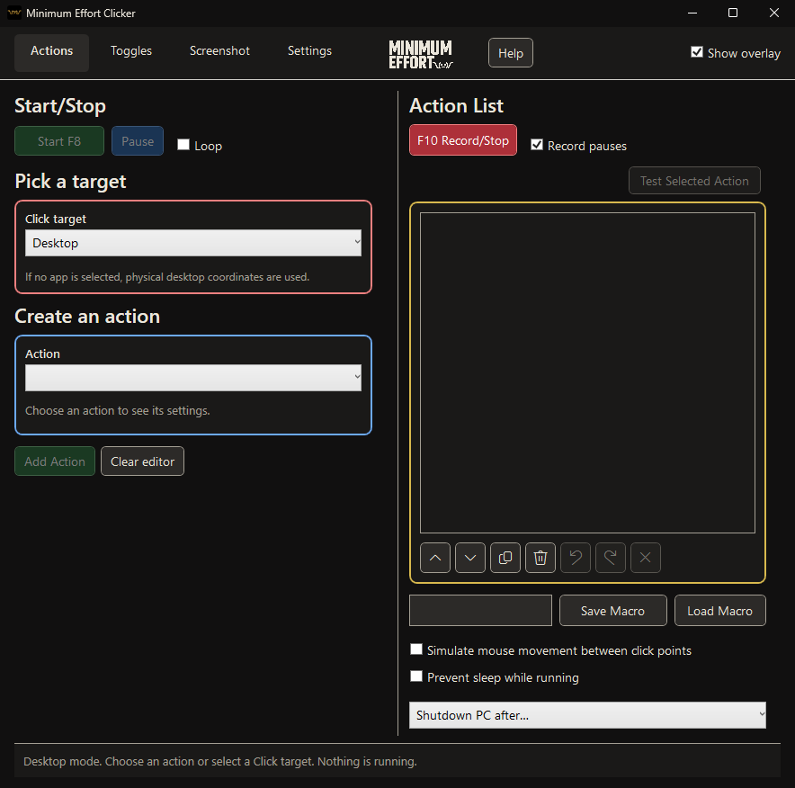
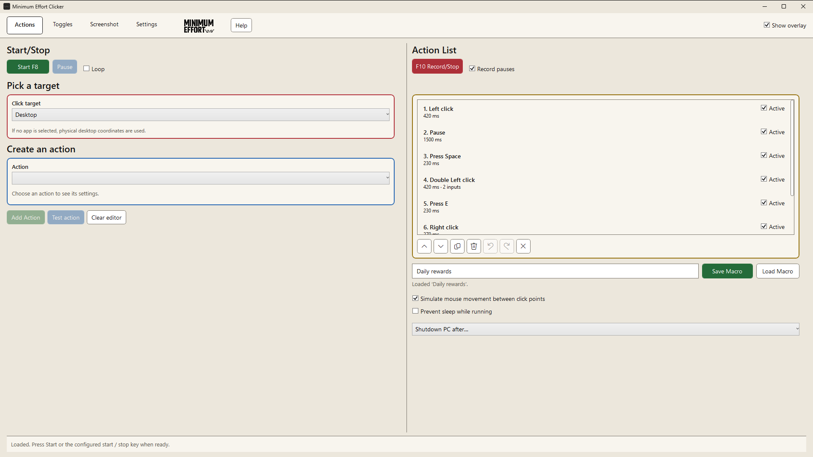
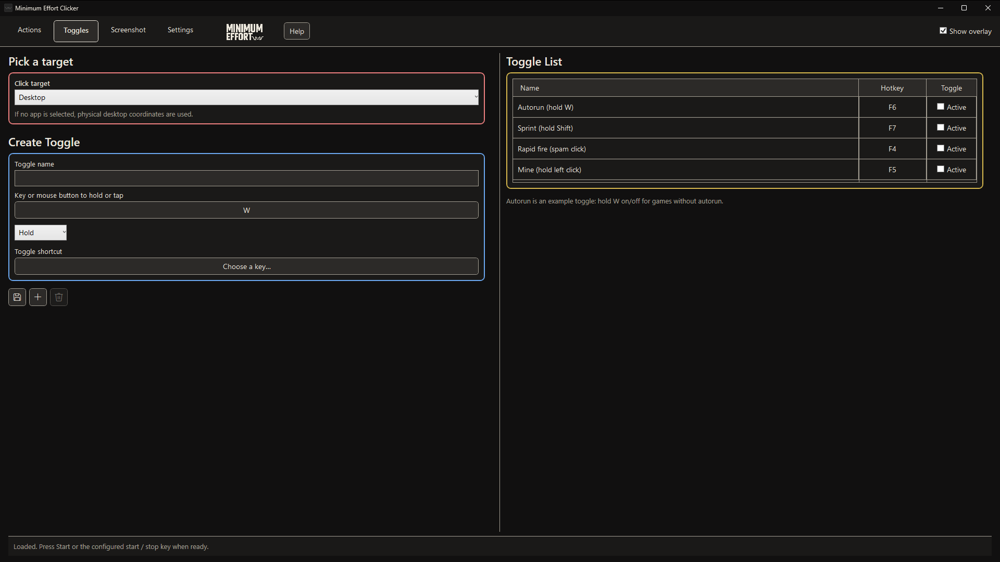
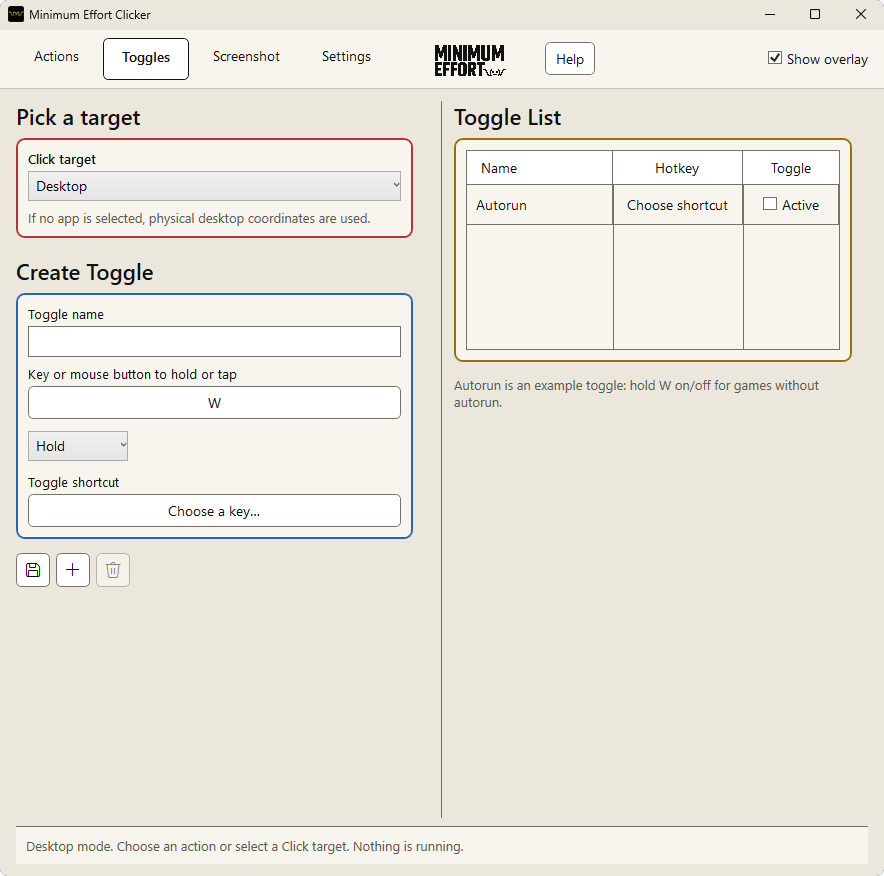
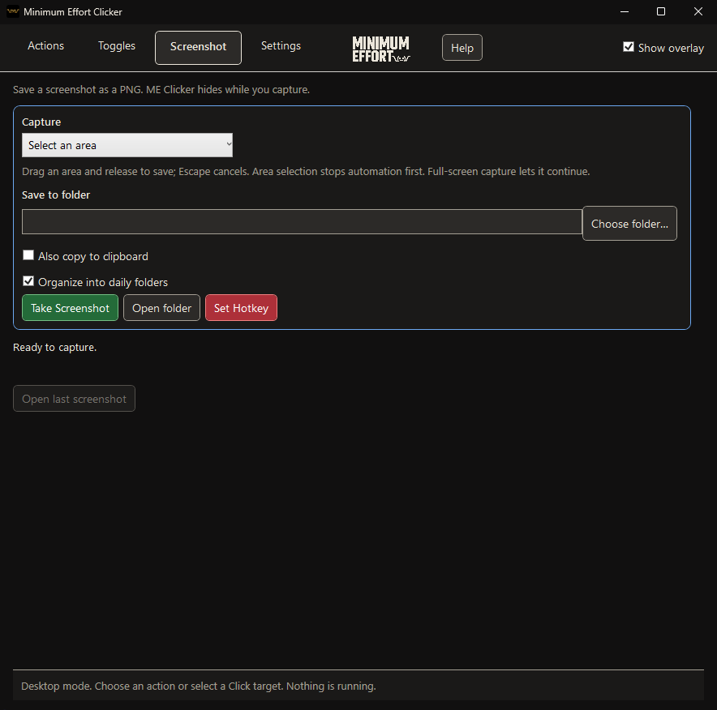
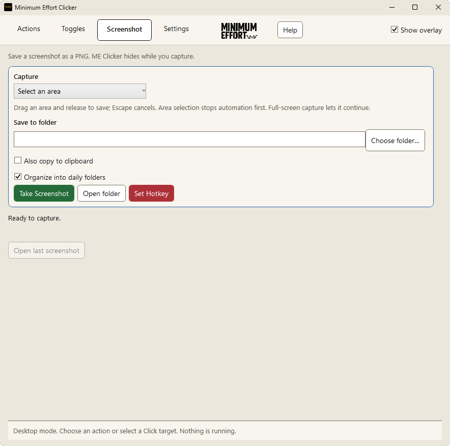
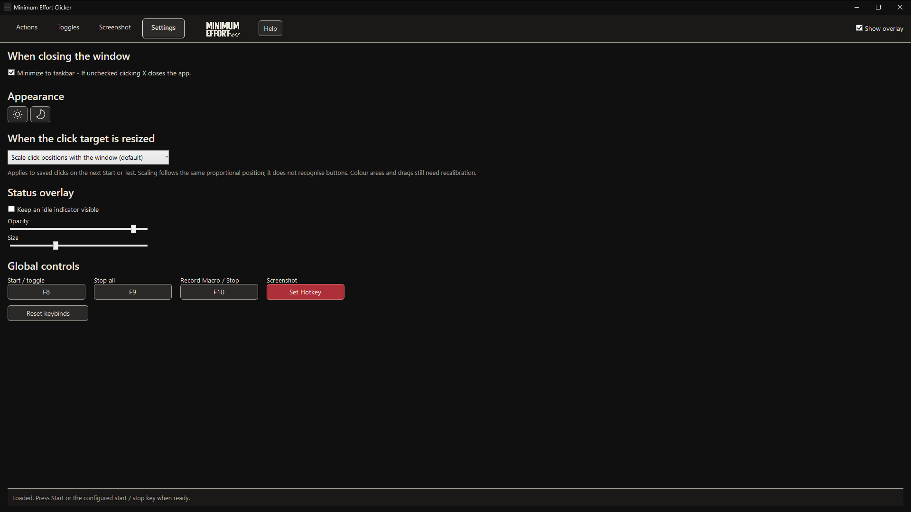
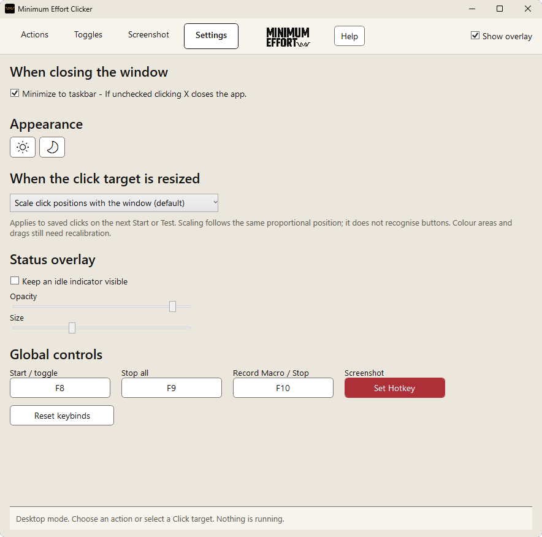

# Minimum Effort Clicker

A free, open-source mouse and keyboard automation app for **Windows 11 x64** and
**Linux** (GNOME and KDE Plasma, see [Linux](docs/LINUX.md)), with the same pages and version on both.
Repeat clicks and keys, record editable action lists, wait for colours on screen, create hold/spam toggles,
run it from a game controller (Xbox, PlayStation, Switch, Steam Deck) or turn controller buttons into keys, and save
screenshots. Runs locally; no account or subscription is needed. It goes online only when you press Send report in Bug report.

**Public preview, not code-signed.** The app is in early testing with more hardware, displays and desktops still
to check, so expect rough edges and please report them. Windows may show a SmartScreen warning the first time.

## What it looks like

Dark and light mode, switched in Settings.

| | Dark | Light |
| --- | --- | --- |
| **Actions** |  |  |
| **Toggles** |  |  |
| **Screenshot** |  |  |
| **Settings** |  |  |

## Download and run

Open this repository's **Releases** page and download the latest release: the Windows x64 portable ZIP
(`MinimumEffortClicker-<version>-win-x64.zip`) or the Linux package (`MinimumEffortClicker-<version>-linux-x64.tar.gz`,
see [Linux](#linux)). GitHub's automatic "Source code" archives contain source, not the runnable app.

1. Extract the complete app ZIP into a new writable folder.
2. Open `MinimumEffortClicker.App.exe`. The .NET runtime is included.
3. Choose your target and review the actions before starting.
4. By default **F6** stops all Actions/toggles/recording, **F7** pauses, **F8** starts/stops Actions, **F9** takes a
   screenshot and **F10** starts/stops recording. Check Settings if you change keys.

Playback starts stopped. Loading/importing and restored focus never start it. If the target window goes behind another window during a run, the run pauses and continues by itself when the window is back in front.
Checked toggles are available for their shortcut, not automatically running.
Use Stop All before exiting; forced process termination cannot guarantee input
cleanup. Closing may minimize to the notification area; use the tray **Exit**
command or disable that behavior in Settings.

Portable settings and macros live in `Data` beside the app. Do not run from inside
the ZIP. Keep the full runtime folder together. For upgrades, extract the new
version into a fresh folder and copy the old `Data` folder next to it: saved
macros are upgraded on load and never reset. The current macro file schema is
**17**; older app versions cannot read newer files. The **Help** button in the
app describes each page.

## Linux

The Linux build (`MinimumEffortClicker-<version>-linux-x64.tar.gz`) has the same pages and controls,
reads the same macro files and needs GNOME (tested on Ubuntu 26.04) or KDE Plasma 6 (checked on CachyOS), on
Wayland. Extract it and run `./install.sh`. On GNOME, log out and back in once so GNOME loads the small ME
Clicker helper extension; on KDE Plasma it works straight away.
Recording, Stop on my input and hotkeys in every app also need input access: press **Turn on** in the app (it asks
for your password in the system window once). Full steps, what the helper can do and current limits are in
[docs/LINUX.md](docs/LINUX.md). Steam Deck support is limited: the app runs in Desktop Mode, and recording sees only
an external mouse or keyboard, not the Deck's own controls; setting up clicks by hand works
([details](docs/LINUX.md#steam-deck-limited-support)).

## Trust and limitations

This preview has **no publisher Authenticode signature**. Windows SmartScreen or
Smart App Control may warn or block it. Do not disable Windows protections to run
the app. SHA-256 checksums and an internal file manifest detect changed bytes;
they are not a signing certificate or a safety guarantee. Trusted signing is
planned separately; see [release status](docs/RELEASE_STATUS.md).

## Build from source

Requires Windows 11 x64 and a **.NET SDK 10.0.4xx** (the build is pinned to
10.0.401 and accepts newer patches). SDK setup and the first package restore need
network access; the app itself runs offline (except Send report in Bug report).

```powershell
.\scripts\Setup-Sdk.ps1 # installs the pinned SDK locally under .tools if you do not have one
.\scripts\Build.ps1
.\scripts\Test.ps1
.\scripts\Build-Public.ps1 -Zip # portable ZIP under artifacts\package
```

Default tests use fake inputs/time/targets and send **no desktop input**. Native
probe tools are separate opt-in tests for an isolated interactive VM, with a stop
route; do not run them as ordinary CI tests. TestTarget is a harmless receiver for
manual testing and is also included in the portable package.

Core/Engine contain the domain and scheduler without WPF dependencies. App is
WPF, Windows handles native integration, Storage handles bounded versioned JSON,
and Vision handles explicit local capture/conditions. Dependencies and lock files
are pinned. Release builds are self-contained and untrimmed.

The Linux build shares Core, Engine and Storage. `MinimumEffortClicker.Linux` holds its native
adapters (GNOME helper or KWin over D-Bus and Wayland, evdev, logind) and `MinimumEffortClicker.Linux.App` is the
Avalonia UI; they build from `MinimumEffortClicker.Linux.slnx` with `scripts/linux/*.sh` and
never change the Windows solution. See [docs/LINUX.md](docs/LINUX.md#build-from-source).

## License and contributions

Application source is licensed under [MIT](LICENSE). Dependencies retain their
own terms: see [third-party notices](THIRD_PARTY_NOTICES.md) and `licenses/`.
MIT does not grant rights to the Minimum Effort trademarks or imply endorsement
of forks. Historical pixel artwork/font with unknown redistribution rights is
excluded from this public repository and release.

Bug reports: press Bug report, next to Help in the app. It sends the report with
the version and system details; or e-mail bugs@minimumeffort.eu. Pull requests are welcome.
Do not post private recordings, screenshots, credentials, or personal data in
issues. See [contributing](CONTRIBUTING.md).
